# Praktikum Komunikasi Data dan Jaringan Komputer Modul 5 - Kelompok K-52

**Operation Geofront** (GNS3 Group C). Laporan resmi untuk soal 1 sampai 10.

| Nama | NRP | Bagian |
|---|---|---|
| Reyhan Adi Satrio | 5027251080 | Soal 1-10 |
| Muhammad Rifki Pribadi | 5027251087 | Soal 11-20 |

---

## Daftar Isi

- [Ringkasan](#ringkasan)
- [Topologi dan konvensi](#topologi-dan-konvensi)
- [Persiapan sebelum demo](#persiapan-sebelum-demo)
- [Babak 1: Membangun Geofront](#babak-1-membangun-geofront)
  - [Soal 1: VLSM dan pohon IP](#soal-1-markas-tanpa-peta-vlsm)
  - [Soal 2: IP router dan forwarding](#soal-2-geofront-gelap-gulita-ip-router)
  - [Soal 3: Routing statis](#soal-3-pulau-pulau-yang-terpisah-routing-statis)
  - [Soal 4: NAT dan internet](#soal-4-haus-kabar-dari-dunia-luar-nat)
  - [Soal 5: Firewall Gendou](#soal-5-pintu-depan-dikunci-rapat-firewall-gendou)
  - [Soal 6: IP statis host](#soal-6-alamat-para-pilot-ip-statis-host)
  - [Soal 7: Listener MAGI](#soal-7-membangunkan-magi-listener)
  - [Soal 8: Kondisi normal layanan](#soal-8-mengenali-kondisi-normal)
- [Babak 2: Sabotase](#babak-2-sabotase)
  - [Soal 9: break_routing.sh](#soal-9-jalur-belakang-diutak-atik-break_routingsh)
  - [Soal 10: break_nat.sh](#soal-10-para-pilot-terkunci-di-dalam-break_natsh)
- [Alur demo singkat](#alur-demo-singkat)
- [Kendala dan catatan teknis](#kendala-dan-catatan-teknis)
- [Lampiran: script semua router](#lampiran-script-semua-router)

---

## Ringkasan

| Soal | Inti | Status | Bukti utama |
|---|---|---|---|
| 1 | VLSM 17 LAN + 16 link, pohon IP | Selesai | Tabel VLSM, `1_pohon_vlsm.png` |
| 2 | IP semua router, `ip_forward=1`, Gendou DHCP dari NAT1 | Selesai | `ip -br addr` 17 router |
| 3 | Routing statis dengan rute minimum dan ringkasan | Selesai | Armisael ping Lilith, Sachiel, Comm-Net |
| 4 | NAT `MASQUERADE` di Gendou, DNS | Selesai | Ping 8.8.8.8 dan deb.debian.org, counter NAT |
| 5 | Policy INPUT/FORWARD DROP di Gendou + 4 izin | Selesai | `iptables -S`, Armisael tetap online |
| 6 | IP statis 25 host, bertahan setelah restart | Selesai | Unit-01 setelah Stop/Start |
| 7 | `netcat-traditional`, listener MAGI | Selesai | Pesan diterima di Casper, Balthasar (5000/5001), Melchior |
| 8 | Layanan Pen-Pen dan Tokyo3-Core | Selesai | 3 balasan, port 22 `Connection refused` seketika |
| 9 | Sabotase routing di Shigeru | Selesai | 4 penyebab ditemukan lewat `diff`, Lilith ping Armisael kembali |
| 10 | Sabotase NAT di Misato dan Gendou | Selesai | 2 penyebab, Unit-01 ping 8.8.8.8 kembali, NAT di Gendou |

**Prefix kelompok:** `192.237.0.0/16`. Seluruh alokasi terpakai berada di `192.237.0.0/21` (`192.237.0.0` sampai `192.237.4.171`). Aturan NAT dan firewall memakai `/16`. Ini keputusan kelompok, karena soal tidak menyebut angka prefix. Fungsinya sama dengan `/21`, sebab tidak ada alamat lain di `192.237.0.0/16` yang dipakai di topologi ini.

**Image semua node:** `ardhptr21/debinet` (Debian 13 trixie).

---

## Topologi dan konvensi

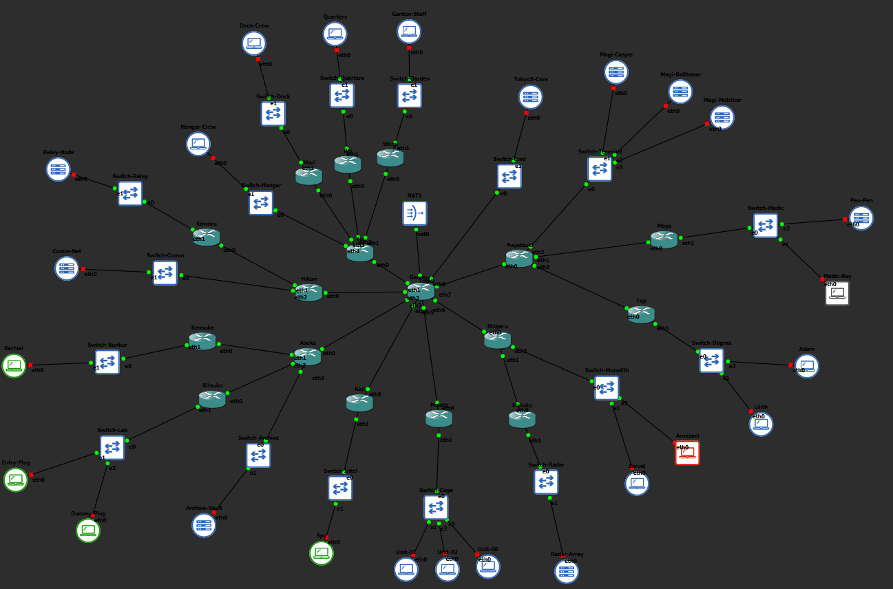

**Pemetaan interface**

- **Gendou:** `eth0` NAT1 (DHCP), `eth1` Yui, `eth2` Hikari, `eth3` Asuka, `eth4` Kaji, `eth5` Misato, `eth6` Shigeru, `eth7` Fuyutsuki, `eth8` Switch-Cmd (Tokyo3-Core).
- **Router anak:** `eth0` selalu uplink ke parent.
  - Yui: `eth1` Shinji, `eth2` Rei, `eth3` Mari, `eth4` Switch-Hangar.
  - Hikari: `eth1` Kaworu, `eth2` Switch-Comm.
  - Asuka: `eth1` Kensuke, `eth2` Ritsuko, `eth3` Switch-Archive.
  - Shigeru: `eth1` Makoto, `eth2` Switch-Monolith.
  - Fuyutsuki: `eth1` Maya, `eth2` Toji, `eth3` Switch-Terminal.
  - Router ujung: `eth1` adalah LAN switch-nya.
- **Host:** hanya `eth0` yang tersambung. `eth1` sampai `eth3` bawaan template dan tidak dipakai.

**Aturan alamat (glosarium):** gateway LAN adalah IP usable pertama subnet. Node di switch mendapat IP berikutnya sesuai urutan kiri ke kanan pada gambar topologi. Urutan sudah dicek di GNS3: Medic-Bay di kiri Pen-Pen, Entry-Plug di kiri Dummy-Plug, Casper-Balthasar-Melchior, Unit-01/02/00, Lilith di kiri Adam, Zeruel di kiri Armisael.

**Cara membaca TTL di bukti ping:** balasan berangkat dengan TTL 64 dan berkurang 1 tiap router yang dilewati. Jadi TTL 60 berarti balasan melewati 4 router.

---

## Persiapan sebelum demo

Yang **bertahan** saat node atau project di-restart: isi `/root` (semua script, `/root/debs`, `/root/baseline`) dan `/etc/network` (konfigurasi IP host). Yang **hilang** di router: IP, rute, `ip_forward`, aturan `iptables`, `resolv.conf`. Listener soal 7-8 juga mati. Program hasil `apt` bisa hilang setelah reset.

Urutan pemulihan:

1. Start semua node. Host langsung mendapat IP sendiri dari `/etc/network/interfaces` (soal 6).
2. **Gendou dulu:** `bash /root/gendou.sh`. Script ini memulihkan DHCP, IP, forwarding, 21 rute, NAT, dan firewall.
3. Router lain (urutan bebas), selalu cek prompt `root@NAMA` sebelum menempel:
   ```
   bash /root/<nama>.sh
   ```
   Nama huruf kecil: `hikari kaworu asuka kensuke ritsuko kaji misato shigeru makoto fuyutsuki maya toji yui rei mari shinji`.
4. Isi DNS router yang perlu mengunduh (Shigeru, Misato, Gendou):
   ```
   grep -q nameserver /etc/resolv.conf || echo "nameserver 192.168.122.1" > /etc/resolv.conf
   ```
5. Nyalakan layanan: `bash /root/casper.sh`, `bash /root/balthasar.sh`, `bash /root/melchior.sh`, `bash /root/pen-pen.sh`, `bash /root/tokyo3-core.sh`. Kalau paket hilang, script memasang ulang `netcat-traditional` sendiri. Karena itu Gendou harus sudah online.
6. Cek cepat:

   ```
   # di Gendou
   ip route | wc -l          # harus 31
   ping -c 2 8.8.8.8
   # di Armisael
   ping -c 2 192.237.4.74    # Lilith, TTL 60
   ping -c 2 8.8.8.8
   ```

Kalau satu link macet satu arah (ARP `FAILED`, `Destination Host Unreachable` dari router sendiri) padahal konfigurasi benar, lihat [Kendala](#kendala-dan-catatan-teknis).

---

# Babak 1: Membangun Geofront

## Soal 1: Markas tanpa peta (VLSM)

**Soal:** bagi prefix kelompok dengan VLSM untuk 17 LAN dan 16 link antar-router. Pakai prefix terkecil yang muat, dan urutkan dari kebutuhan terbesar. Tampilkan tabel, pohon IP dengan subnet jalur Dummy-Plug ke Armisael dilingkari, dan jelaskan hitungan satu subnet.

**Cara kerja:**

1. Kebutuhan alamat tiap LAN = **jumlah host + 1 (gateway) + 2 (network dan broadcast)**.
2. Bulatkan ke pangkat 2 terdekat ke atas. Prefix = 32 - log2(blok).
3. Alokasikan dari blok terbesar ke terkecil, berurutan dari `192.237.0.0`. Kalau ukurannya sama, LAN didahulukan sebelum link.
4. Link router-router selalu `/30` (2 IP usable).

**Hitungan satu subnet: Switch-Quarters (Rei), 500 host**

- Butuh 500 + 1 + 2 = **503** alamat.
- Pangkat 2 terdekat yang memuat 503 adalah 2^9 = **512**. Jadi prefix = 32 - 9 = **/23**.
- Network `192.237.0.0/23`, netmask `255.255.254.0`.
- Rentang `192.237.0.0` sampai `192.237.1.255`. Satu `/23` mencakup dua blok `/24`.
- Gateway (IP usable pertama) `192.237.0.1`. Host pertama `192.237.0.2`, host terakhir `192.237.1.254`, broadcast `192.237.1.255`.
- Sisa: 512 - 503 = **9** alamat.

Catatan: gateway Hikari mulai di `192.237.2.1` karena `192.237.0.0` sampai `192.237.1.255` sudah habis dipakai Quarters. Quarters tetap memiliki 510 IP usable, bukan 254.

### Tabel VLSM LAN

| No | LAN | Router | Host | Butuh | Blok | Network | Netmask | Gateway | Host terakhir | Broadcast | Sisa |
|---|---|---|---|---|---|---|---|---|---|---|---|
| 1 | Switch-Quarters | Rei | 500 | 503 | 512 | `192.237.0.0/23` | 255.255.254.0 | 192.237.0.1 | 192.237.1.254 | 192.237.1.255 | 9 |
| 2 | Switch-Comm | Hikari | 200 | 203 | 256 | `192.237.2.0/24` | 255.255.255.0 | 192.237.2.1 | 192.237.2.254 | 192.237.2.255 | 53 |
| 3 | Switch-Hangar | Yui | 100 | 103 | 128 | `192.237.3.0/25` | 255.255.255.128 | 192.237.3.1 | 192.237.3.126 | 192.237.3.127 | 25 |
| 4 | Switch-Bunker | Kensuke | 55 | 58 | 64 | `192.237.3.128/26` | 255.255.255.192 | 192.237.3.129 | 192.237.3.190 | 192.237.3.191 | 6 |
| 5 | Switch-Medic | Maya | 26 | 29 | 32 | `192.237.3.192/27` | 255.255.255.224 | 192.237.3.193 | 192.237.3.222 | 192.237.3.223 | 3 |
| 6 | Switch-Relay | Kaworu | 25 | 28 | 32 | `192.237.3.224/27` | 255.255.255.224 | 192.237.3.225 | 192.237.3.254 | 192.237.3.255 | 4 |
| 7 | Switch-Garden | Shinji | 14 | 17 | 32 | `192.237.4.0/27` | 255.255.255.224 | 192.237.4.1 | 192.237.4.30 | 192.237.4.31 | 15 |
| 8 | Switch-Dock | Mari | 12 | 15 | 16 | `192.237.4.32/28` | 255.255.255.240 | 192.237.4.33 | 192.237.4.46 | 192.237.4.47 | 1 |
| 9 | Switch-Lab | Ritsuko | 5 | 8 | 8 | `192.237.4.48/29` | 255.255.255.248 | 192.237.4.49 | 192.237.4.54 | 192.237.4.55 | 0 |
| 10 | Switch-Terminal | Fuyutsuki | 3 | 6 | 8 | `192.237.4.56/29` | 255.255.255.248 | 192.237.4.57 | 192.237.4.62 | 192.237.4.63 | 2 |
| 11 | Switch-Cage | Misato | 3 | 6 | 8 | `192.237.4.64/29` | 255.255.255.248 | 192.237.4.65 | 192.237.4.70 | 192.237.4.71 | 2 |
| 12 | Switch-Dogma | Toji | 2 | 5 | 8 | `192.237.4.72/29` | 255.255.255.248 | 192.237.4.73 | 192.237.4.78 | 192.237.4.79 | 3 |
| 13 | Switch-Monolith | Shigeru | 2 | 5 | 8 | `192.237.4.80/29` | 255.255.255.248 | 192.237.4.81 | 192.237.4.86 | 192.237.4.87 | 3 |
| 14 | Switch-Radar | Makoto | 4 | 7 | 8 | `192.237.4.88/29` | 255.255.255.248 | 192.237.4.89 | 192.237.4.94 | 192.237.4.95 | 1 |
| 15 | Switch-Archive | Asuka | 1 | 4 | 4 | `192.237.4.96/30` | 255.255.255.252 | 192.237.4.97 | 192.237.4.98 | 192.237.4.99 | 0 |
| 16 | Switch-Intel | Kaji | 1 | 4 | 4 | `192.237.4.100/30` | 255.255.255.252 | 192.237.4.101 | 192.237.4.102 | 192.237.4.103 | 0 |
| 17 | Switch-Cmd | Gendou | 1 | 4 | 4 | `192.237.4.104/30` | 255.255.255.252 | 192.237.4.105 | 192.237.4.106 | 192.237.4.107 | 0 |

Kolom **Butuh** = host + 1 gateway + 2 (network dan broadcast). **Sisa** = blok - butuh. Host pertama selalu gateway + 1.

### Tabel link antar-router (/30)

| No | Parent | Child | Network | IP parent | IP child | If parent | If child |
|---|---|---|---|---|---|---|---|
| 1 | Gendou | Hikari | `192.237.4.108/30` | 192.237.4.109 | 192.237.4.110 | eth2 | eth0 |
| 2 | Gendou | Yui | `192.237.4.112/30` | 192.237.4.113 | 192.237.4.114 | eth1 | eth0 |
| 3 | Gendou | Asuka | `192.237.4.116/30` | 192.237.4.117 | 192.237.4.118 | eth3 | eth0 |
| 4 | Gendou | Kaji | `192.237.4.120/30` | 192.237.4.121 | 192.237.4.122 | eth4 | eth0 |
| 5 | Gendou | Misato | `192.237.4.124/30` | 192.237.4.125 | 192.237.4.126 | eth5 | eth0 |
| 6 | Gendou | Shigeru | `192.237.4.128/30` | 192.237.4.129 | 192.237.4.130 | eth6 | eth0 |
| 7 | Gendou | Fuyutsuki | `192.237.4.132/30` | 192.237.4.133 | 192.237.4.134 | eth7 | eth0 |
| 8 | Hikari | Kaworu | `192.237.4.136/30` | 192.237.4.137 | 192.237.4.138 | eth1 | eth0 |
| 9 | Yui | Rei | `192.237.4.140/30` | 192.237.4.141 | 192.237.4.142 | eth2 | eth0 |
| 10 | Yui | Mari | `192.237.4.144/30` | 192.237.4.145 | 192.237.4.146 | eth3 | eth0 |
| 11 | Yui | Shinji | `192.237.4.148/30` | 192.237.4.149 | 192.237.4.150 | eth1 | eth0 |
| 12 | Asuka | Kensuke | `192.237.4.152/30` | 192.237.4.153 | 192.237.4.154 | eth1 | eth0 |
| 13 | Asuka | Ritsuko | `192.237.4.156/30` | 192.237.4.157 | 192.237.4.158 | eth2 | eth0 |
| 14 | Fuyutsuki | Maya | `192.237.4.160/30` | 192.237.4.161 | 192.237.4.162 | eth1 | eth0 |
| 15 | Fuyutsuki | Toji | `192.237.4.164/30` | 192.237.4.165 | 192.237.4.166 | eth2 | eth0 |
| 16 | Shigeru | Makoto | `192.237.4.168/30` | 192.237.4.169 | 192.237.4.170 | eth1 | eth0 |

**Total:** LAN 1132 + link 64 = **1196 alamat**, berakhir di `192.237.4.171`.

### Pohon IP

Subnet yang dilingkari merah adalah jalur Dummy-Plug ke Armisael:
Lab `192.237.4.48/29`, lalu link Ritsuko-Asuka `192.237.4.156/30`, link Asuka-Gendou `192.237.4.116/30`, link Gendou-Shigeru `192.237.4.128/30`, dan Monolith `192.237.4.80/29`.

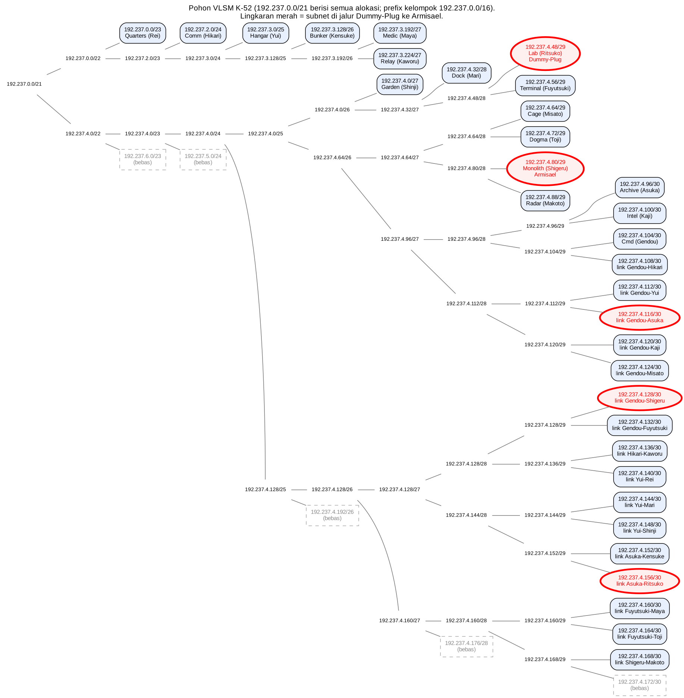

---

## Soal 2: Geofront gelap gulita (IP router)

**Soal:** pasang topologi di GNS3, beri IP ke tiap interface router sesuai soal 1, dan aktifkan IP forwarding di semua router. Hanya Gendou yang mendapat alamat lewat DHCP dari NAT1. Tunjukkan `ip -br` tiap router dan ping dua ujung tiap link.

**Cara kerja:** tiap router punya script `/root/<nama>.sh` yang aman dijalankan berulang (`ip addr replace`, bukan `add`). Isinya ada di [Lampiran](#lampiran-script-semua-router). Gendou mengambil `eth0` dari NAT1 dengan `dhclient`. Paket `.deb` `dhclient` disimpan di `/root/debs`, supaya bisa dipasang ulang tanpa internet kalau hilang setelah reset.

**Perintah demo (di tiap router):**

```
ip -br addr; cat /proc/sys/net/ipv4/ip_forward
```

**Hasil yang diharapkan:** setiap interface memiliki IP sesuai tabel link dan LAN, dan baris terakhir bernilai `1`.

**Gendou**

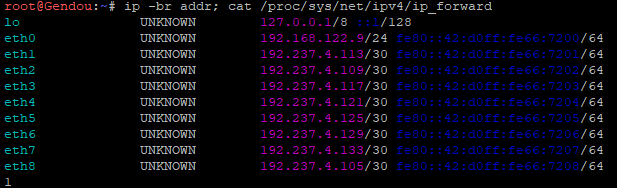

**Yui**

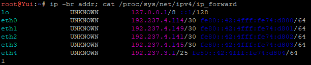


**Rei**

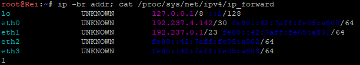

**Mari**

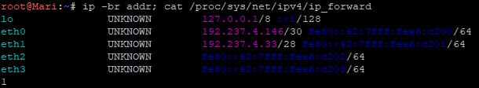

**Hikari**

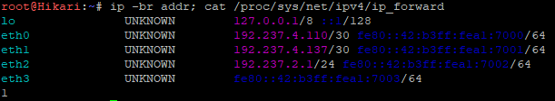

**Kaworu**

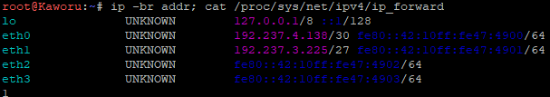

**Asuka**

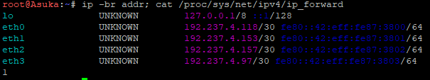

**Kensuke**

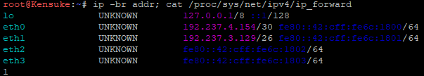

**Ritsuko**

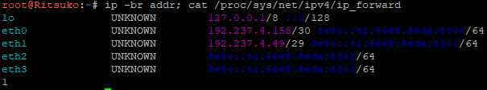

**Kaji**

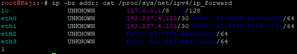

**Misato**

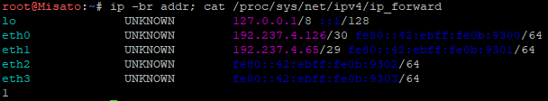

**Shigeru**

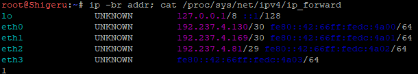

**Fuyutsuki**

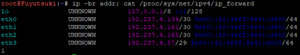

**Maya**

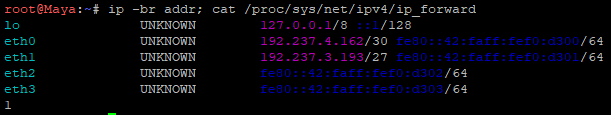

**Toji**

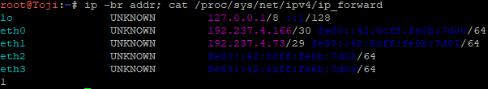


**Ping dua ujung link (contoh dari router anak ke parent):**

```
# contoh di Hikari
ping -c 2 192.237.4.109
```

**DHCP Gendou:**

```
ip -br addr show eth0; ip route | grep default
```

---

## Soal 3: Pulau-pulau yang terpisah (routing statis)

**Soal:** hubungkan semua subnet dengan routing statis dan jumlah rute sesedikit mungkin. Router selain Gendou cukup punya satu default route ke atas dan rute untuk subnet di bawahnya. Gendou memakai default route ke NAT1. Subnet satu cabang yang bisa digabung tepat menjadi satu CIDR harus diringkas. Buktikan Armisael bisa ping Lilith, Sachiel, dan Comm-Net.

**Analogi:** Gendou adalah kantor pusat yang punya buku alamat lengkap: "LAN ini lewat cabang Yui, LAN itu lewat cabang Asuka". Router cabang cukup tahu dua hal: alamat di bawahnya, dan "selain itu, serahkan ke atasan" (default route).

**Rute per router (tambahan di luar rute terhubung):**

| Router | Rute ke bawah | Default route |
|---|---|---|
| Gendou | 21 rute (lihat script Gendou) | `192.168.122.1` (NAT1, dari DHCP) |
| Hikari | `192.237.3.224/27` via 192.237.4.138 (Kaworu) | `192.237.4.109` (Gendou) |
| Kaworu | - | `192.237.4.137` (Hikari) |
| Asuka | `192.237.3.128/26` via 192.237.4.154 (Kensuke)<br>`192.237.4.48/29` via 192.237.4.158 (Ritsuko) | `192.237.4.117` (Gendou) |
| Kensuke | - | `192.237.4.153` (Asuka) |
| Ritsuko | - | `192.237.4.157` (Asuka) |
| Kaji | - | `192.237.4.121` (Gendou) |
| Misato | - | `192.237.4.125` (Gendou) |
| Shigeru | `192.237.4.88/29` via 192.237.4.170 (Makoto) | `192.237.4.129` (Gendou) |
| Makoto | - | `192.237.4.169` (Shigeru) |
| Fuyutsuki | `192.237.3.192/27` via 192.237.4.162 (Maya)<br>`192.237.4.72/29` via 192.237.4.166 (Toji) | `192.237.4.133` (Gendou) |
| Maya | - | `192.237.4.161` (Fuyutsuki) |
| Toji | - | `192.237.4.165` (Fuyutsuki) |
| Yui | `192.237.0.0/23` via 192.237.4.142 (Rei)<br>`192.237.4.32/28` via 192.237.4.146 (Mari)<br>`192.237.4.0/27` via 192.237.4.150 (Shinji) | `192.237.4.113` (Gendou) |
| Rei | - | `192.237.4.141` (Yui) |
| Mari | - | `192.237.4.145` (Yui) |
| Shinji | - | `192.237.4.149` (Yui) |

**Ringkasan CIDR di Gendou:** subnet yang bersebelahan dan berada di satu cabang digabung.

- `192.237.4.80/29` (Monolith) + `192.237.4.88/29` (Radar) menjadi `192.237.4.80/28` lewat Shigeru.
- Link `192.237.4.144/30` + `192.237.4.148/30` menjadi `192.237.4.144/29` lewat Yui.
- Link `192.237.4.152/30` + `192.237.4.156/30` menjadi `192.237.4.152/29` lewat Asuka.
- Link `192.237.4.160/30` + `192.237.4.164/30` menjadi `192.237.4.160/29` lewat Fuyutsuki.

Hasilnya, Gendou memiliki **21 rute statis**. Ditambah default dan 9 rute terhubung, totalnya `ip route | wc -l` = **31**.

**IP sementara node uji (soal 3-5).** IP permanen baru dibuat di soal 6. Saat soal 3, Armisael masih memakai `.82`, lalu dipindah ke `.83` di soal 6 sesuai urutan kiri-ke-kanan.

```
# Armisael (sementara)
ip addr add 192.237.4.82/29 dev eth0; ip route add default via 192.237.4.81
# Lilith / Sachiel / Comm-Net
ip addr add 192.237.4.74/29 dev eth0;  ip route add default via 192.237.4.73
ip addr add 192.237.3.130/26 dev eth0; ip route add default via 192.237.3.129
ip addr add 192.237.2.2/24 dev eth0;   ip route add default via 192.237.2.1
```

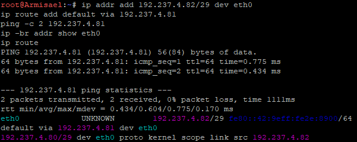
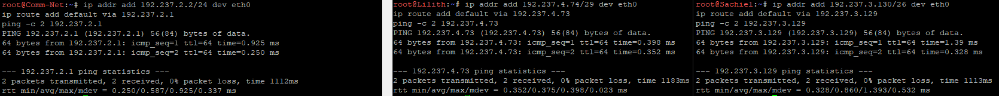

**Tabel rute:**

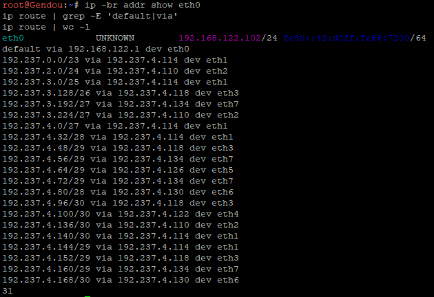
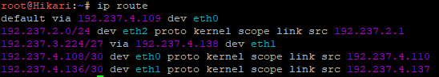
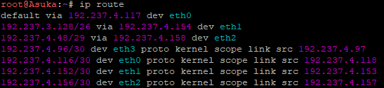
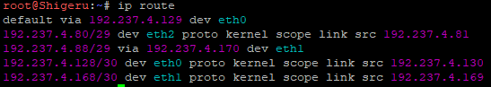
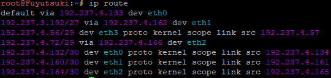
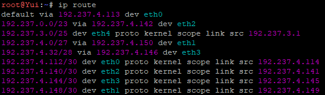

**Bukti semua gateway LAN terjangkau dari Gendou:**

```
for ip in 192.237.0.1 192.237.2.1 192.237.3.1 192.237.3.129 192.237.3.193 192.237.3.225 192.237.4.1 192.237.4.33 192.237.4.49 192.237.4.57 192.237.4.65 192.237.4.73 192.237.4.81 192.237.4.89 192.237.4.97 192.237.4.101 192.237.4.105; do ping -c 1 -W 1 $ip >/dev/null && echo "$ip OK" || echo "$ip GAGAL"; done
```

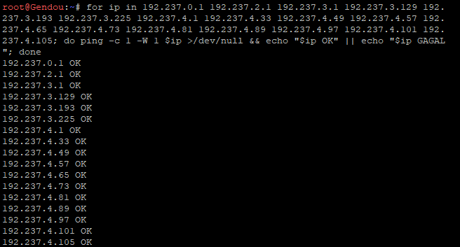

**Bukti utama (diminta soal):**

```
# di Armisael
ping -c 3 192.237.4.74     # Lilith
ping -c 3 192.237.3.130    # Sachiel
ping -c 3 192.237.2.2      # Comm-Net
```

**Hasil:** semua 0% loss, dengan TTL 60, 60, dan 61.

- Lilith: balasan melewati Toji, Fuyutsuki, Gendou, Shigeru (4 router, TTL 60).
- Sachiel: balasan melewati Kensuke, Asuka, Gendou, Shigeru (4 router, TTL 60).
- Comm-Net: balasan melewati Hikari, Gendou, Shigeru (3 router, TTL 61).

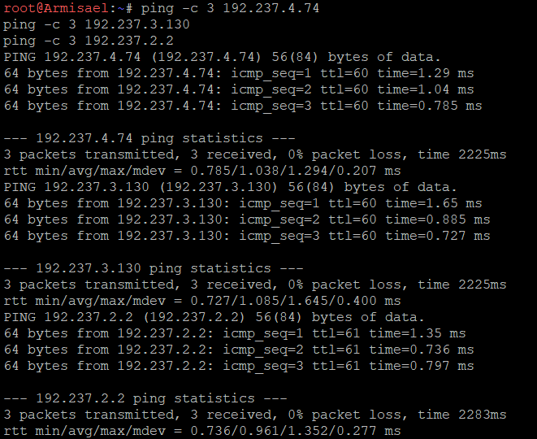

---

## Soal 4: Haus kabar dari dunia luar (NAT)

**Soal:** beri seluruh jaringan akses internet lewat Gendou. Konfigurasinya tidak boleh perlu diubah saat IP NAT1 berganti. Hanya traffic dari prefix internal yang keluar lewat NAT1 yang diterjemahkan, sedangkan traffic antar-LAN tetap membawa alamat asli. Node juga harus bisa me-resolve domain. Buktikan ping 8.8.8.8 dan deb.debian.org dari Armisael dan Lilith, dan tunjukkan counter NAT.

**Analogi:** NAT seperti kantor pos di gerbang kompleks. Surat warga yang keluar kompleks ditempeli alamat kantor pos sebagai pengirim, supaya balasan dari luar bisa kembali. Surat antar-warga di dalam kompleks tidak disentuh.

**Konfigurasi (bagian dari `/root/gendou.sh`):**

```
iptables -t nat -C POSTROUTING -s 192.237.0.0/16 -o eth0 -j MASQUERADE 2>/dev/null || \
iptables -t nat -A POSTROUTING -s 192.237.0.0/16 -o eth0 -j MASQUERADE
```

**Kenapa begini:**

- **`MASQUERADE`, bukan `SNAT --to-source`:** `MASQUERADE` selalu memakai IP `eth0` saat itu. Jadi kalau DHCP NAT1 memberi IP baru, aturan tidak perlu diubah.
- **`-s 192.237.0.0/16 -o eth0`:** hanya paket dari prefix internal yang keluar ke NAT1 yang diterjemahkan. Paket antar-LAN tidak keluar lewat `eth0`, jadi alamat aslinya tetap.
- **Pola `-C ... || -A ...`:** aturan hanya ditambahkan kalau belum ada, jadi script aman dijalankan berulang.
- **DNS:** host memakai `nameserver 192.168.122.1`, ditulis otomatis oleh baris `up` di `/etc/network/interfaces` (soal 6). Saat soal 4, DNS host diisi manual dengan nilai yang sama.

**Bukti:**

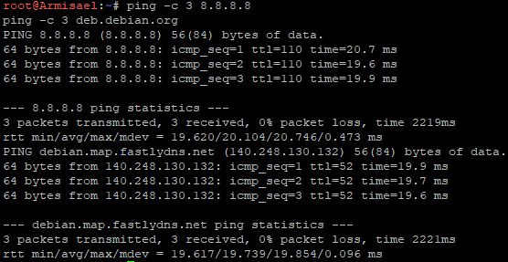
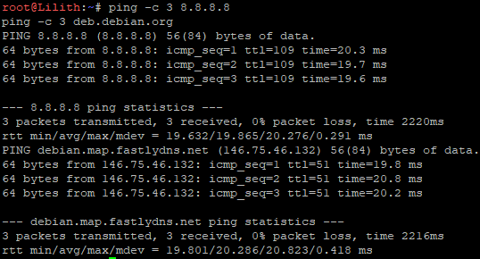

```
# di Gendou
iptables -t nat -L POSTROUTING -n -v
```

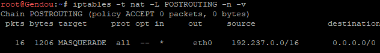

**Traffic antar-LAN tetap membawa alamat asli:** `tcpdump` di Lilith saat Armisael melakukan ping menunjukkan sumber `192.237.4.82` (IP Armisael saat itu), bukan IP Gendou.

```
# di Lilith (sambil Armisael ping Lilith)
timeout 30 tcpdump -n -i eth0 icmp -c 3
```

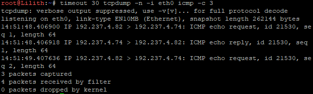

Catatan: counter NAT hanya bertambah untuk paket pertama tiap aliran, karena tabel `nat` hanya diperiksa saat koneksi baru dibuat. Jadi 3 ping dalam satu aliran terhitung 1.

---

## Soal 5: Pintu depan dikunci rapat (firewall Gendou)

**Soal:** di Gendou, ubah policy INPUT dan FORWARD menjadi DROP, lalu izinkan: (a) balasan koneksi yang sudah ada, (b) internal ke internet, (c) antar-LAN, (d) internal ke Gendou sendiri. Loopback dan DHCP dari NAT1 tetap jalan, dan koneksi baru dari sisi NAT1 tidak boleh masuk. Semuanya ditulis di script Gendou. Tunjukkan `iptables -S` dan buktikan ping 8.8.8.8 dari Armisael masih berhasil.

**Konfigurasi (bagian akhir `/root/gendou.sh`):**

```
ipt() { iptables -C "$@" 2>/dev/null || iptables -A "$@"; }
ipt INPUT -m conntrack --ctstate ESTABLISHED,RELATED -j ACCEPT    # (a) balasan
ipt INPUT -i lo -j ACCEPT                                          # loopback
ipt INPUT -i eth0 -p udp --sport 67 --dport 68 -j ACCEPT           # DHCP dari NAT1
ipt INPUT -s 192.237.0.0/16 -j ACCEPT                              # (d) internal ke Gendou
ipt FORWARD -m conntrack --ctstate ESTABLISHED,RELATED -j ACCEPT  # (a) balasan
ipt FORWARD -s 192.237.0.0/16 -o eth0 -j ACCEPT                    # (b) internal ke internet
ipt FORWARD -s 192.237.0.0/16 -d 192.237.0.0/16 -j ACCEPT          # (c) antar-LAN
iptables -P INPUT DROP
iptables -P FORWARD DROP
```

**Kenapa urutannya begini:** semua aturan izin dipasang **lebih dulu**, baru policy diubah ke DROP di akhir. Kalau terbalik, ada jeda saat semua lalu lintas terputus, termasuk koneksi yang sedang dipakai.

**Kenapa koneksi baru dari NAT1 tertolak:** paket baru dari `eth0` tidak cocok dengan aturan izin mana pun. Ia bukan balasan, bukan dari `192.237.0.0/16`, dan bukan DHCP. Jadi paket itu jatuh ke policy DROP. Balasan dari internet tetap masuk lewat aturan `ESTABLISHED,RELATED`.

**Bukti:**

```
# di Gendou
iptables -S
iptables -L -n -v --line-numbers
iptables -S -v
```

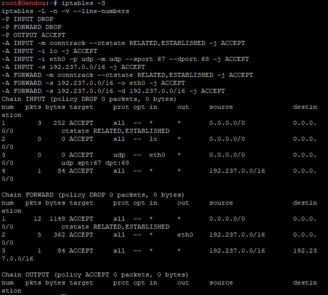
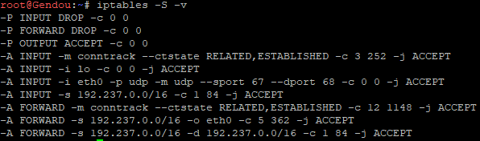

```
# di Armisael
ping -c 2 8.8.8.8; ping -c 2 deb.debian.org; ping -c 2 192.237.4.74; ping -c 2 192.237.4.129
```

**Hasil:** internet, DNS, antar-LAN (Lilith), dan Gendou sendiri (`.129`) tetap berhasil setelah policy DROP.

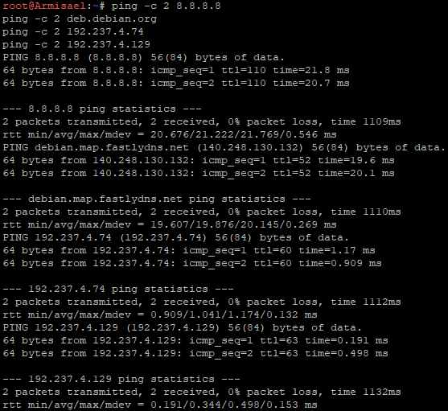

### Script lengkap Gendou (`/root/gendou.sh`, soal 2 sampai 5)

```bash
#!/bin/bash
# gendou.sh - Gendou: rute (soal 3), NAT (soal 4), firewall (soal 5). Aman dijalankan berulang.

# eth0: DHCP dari NAT1
ip link set eth0 up
command -v dhclient >/dev/null || dpkg -i /root/debs/isc-dhcp-common_*.deb /root/debs/isc-dhcp-client_*.deb
pidof dhclient >/dev/null || dhclient eth0

# IP forwarding
echo 1 > /proc/sys/net/ipv4/ip_forward

# Link ke router lain dan LAN Cmd
ip addr replace 192.237.4.113/30 dev eth1   # Yui
ip addr replace 192.237.4.109/30 dev eth2   # Hikari
ip addr replace 192.237.4.117/30 dev eth3   # Asuka
ip addr replace 192.237.4.121/30 dev eth4   # Kaji
ip addr replace 192.237.4.125/30 dev eth5   # Misato
ip addr replace 192.237.4.129/30 dev eth6   # Shigeru
ip addr replace 192.237.4.133/30 dev eth7   # Fuyutsuki
ip addr replace 192.237.4.105/30 dev eth8   # Switch-Cmd
for i in 1 2 3 4 5 6 7 8; do ip link set eth$i up; done
# --- static routes ---
ip route replace 192.237.2.0/24   via 192.237.4.110   # Hikari
ip route replace 192.237.3.224/27 via 192.237.4.110
ip route replace 192.237.4.136/30 via 192.237.4.110
ip route replace 192.237.3.128/26 via 192.237.4.118   # Asuka
ip route replace 192.237.4.48/29  via 192.237.4.118
ip route replace 192.237.4.96/30  via 192.237.4.118
ip route replace 192.237.4.152/29 via 192.237.4.118
ip route replace 192.237.4.100/30 via 192.237.4.122   # Kaji
ip route replace 192.237.4.64/29  via 192.237.4.126   # Misato
ip route replace 192.237.4.80/28  via 192.237.4.130   # Shigeru
ip route replace 192.237.4.168/30 via 192.237.4.130
ip route replace 192.237.3.192/27 via 192.237.4.134   # Fuyutsuki
ip route replace 192.237.4.56/29  via 192.237.4.134
ip route replace 192.237.4.72/29  via 192.237.4.134
ip route replace 192.237.4.160/29 via 192.237.4.134
ip route replace 192.237.0.0/23   via 192.237.4.114   # Yui
ip route replace 192.237.3.0/25   via 192.237.4.114
ip route replace 192.237.4.0/27   via 192.237.4.114
ip route replace 192.237.4.32/28  via 192.237.4.114
ip route replace 192.237.4.140/30 via 192.237.4.114
ip route replace 192.237.4.144/29 via 192.237.4.114
# --- NAT (soal 4) ---
iptables -t nat -C POSTROUTING -s 192.237.0.0/16 -o eth0 -j MASQUERADE 2>/dev/null || iptables -t nat -A POSTROUTING -s 192.237.0.0/16 -o eth0 -j MASQUERADE
# --- Firewall Gendou (soal 5): aturan izin ---
ipt() { iptables -C "$@" 2>/dev/null || iptables -A "$@"; }
ipt INPUT -m conntrack --ctstate ESTABLISHED,RELATED -j ACCEPT
ipt INPUT -i lo -j ACCEPT
ipt INPUT -i eth0 -p udp --sport 67 --dport 68 -j ACCEPT
ipt INPUT -s 192.237.0.0/16 -j ACCEPT
ipt FORWARD -m conntrack --ctstate ESTABLISHED,RELATED -j ACCEPT
ipt FORWARD -s 192.237.0.0/16 -o eth0 -j ACCEPT
ipt FORWARD -s 192.237.0.0/16 -d 192.237.0.0/16 -j ACCEPT
# --- policy terkunci (soal 5), paling akhir ---
iptables -P INPUT DROP
iptables -P FORWARD DROP
```

---

## Soal 6: Alamat para pilot (IP statis host)

**Soal:** beri IP statis dan gateway ke semua node non-router sesuai aturan glosarium. Simpan agar bertahan setelah restart. Tunjukkan `ip -br` dan ping ke gateway di Unit-01.

**Temuan cara persistensi** (dibuktikan dengan membaca skrip start container, bukan menebak):

- PID 1 container adalah `dumb-init -- /etc/debinet-init.sh`.
- Sebelum itu, skrip GNS3 `/gns3/init.sh` menjalankan **`ifup -a -f`** setiap node menyala. `ifup` ini applet busybox dari `/gns3/bin`, bukan paket `ifupdown`, yang memang tidak terpasang di image.
- `mount` menunjukkan `/etc/network` dan `/root` di-*bind mount* dari volume GNS3, jadi isinya bertahan.

Kesimpulannya: cukup tulis `/etc/network/interfaces`. GNS3 akan memasangnya sendiri setiap node start.

**Contoh konfigurasi (Unit-01):**

```
cat > /etc/network/interfaces << 'EOF'
auto eth0
iface eth0 inet static
    address 192.237.4.66
    netmask 255.255.255.248
    gateway 192.237.4.65
    up echo nameserver 192.168.122.1 > /etc/resolv.conf
EOF
ip addr flush dev eth0
/gns3/bin/busybox ifup eth0
```

Baris `up echo nameserver ...` menulis DNS setiap interface naik, sehingga DNS host juga bertahan.

**Tabel IP host (25 node):**

| Node | IP | Gateway | Switch (router) |
|---|---|---|---|
| Quarters | `192.237.0.2/23` | 192.237.0.1 | Quarters (Rei) |
| Comm-Net | `192.237.2.2/24` | 192.237.2.1 | Comm (Hikari) |
| Hangar-Crew | `192.237.3.2/25` | 192.237.3.1 | Hangar (Yui) |
| Sachiel | `192.237.3.130/26` | 192.237.3.129 | Bunker (Kensuke) |
| Medic-Bay | `192.237.3.194/27` | 192.237.3.193 | Medic (Maya) |
| Pen-Pen | `192.237.3.195/27` | 192.237.3.193 | Medic (Maya) |
| Relay-Node | `192.237.3.226/27` | 192.237.3.225 | Relay (Kaworu) |
| Garden-Staff | `192.237.4.2/27` | 192.237.4.1 | Garden (Shinji) |
| Dock-Crew | `192.237.4.34/28` | 192.237.4.33 | Dock (Mari) |
| Entry-Plug | `192.237.4.50/29` | 192.237.4.49 | Lab (Ritsuko) |
| Dummy-Plug | `192.237.4.51/29` | 192.237.4.49 | Lab (Ritsuko) |
| Magi-Casper | `192.237.4.58/29` | 192.237.4.57 | Terminal (Fuyutsuki) |
| Magi-Balthasar | `192.237.4.59/29` | 192.237.4.57 | Terminal (Fuyutsuki) |
| Magi-Melchior | `192.237.4.60/29` | 192.237.4.57 | Terminal (Fuyutsuki) |
| Unit-01 | `192.237.4.66/29` | 192.237.4.65 | Cage (Misato) |
| Unit-02 | `192.237.4.67/29` | 192.237.4.65 | Cage (Misato) |
| Unit-00 | `192.237.4.68/29` | 192.237.4.65 | Cage (Misato) |
| Lilith | `192.237.4.74/29` | 192.237.4.73 | Dogma (Toji) |
| Adam | `192.237.4.75/29` | 192.237.4.73 | Dogma (Toji) |
| Zeruel | `192.237.4.82/29` | 192.237.4.81 | Monolith (Shigeru) |
| Armisael | `192.237.4.83/29` | 192.237.4.81 | Monolith (Shigeru) |
| Radar-Array | `192.237.4.90/29` | 192.237.4.89 | Radar (Makoto) |
| Archive-Vault | `192.237.4.98/30` | 192.237.4.97 | Archive (Asuka) |
| Spy | `192.237.4.102/30` | 192.237.4.101 | Intel (Kaji) |
| Tokyo3-Core | `192.237.4.106/30` | 192.237.4.105 | Cmd (Gendou) |

Seluruh 25 host sudah diterapkan dan ping ke gateway masing-masing 0% loss.

**Script cadangan:** `/root/ip-host.sh` bisa ditempel di host mana pun. Script ini membaca hostname, memilih IP yang sesuai, dan menolak berjalan kalau ditempel di router.

<details>
<summary>Isi <code>ip-host.sh</code></summary>

```bash
#!/bin/bash
# ip-host.sh - IP statis host (soal 6). Satu script yang sama untuk semua 25 host.
# Nama node dibaca dari hostname. Kalau bukan host yang dikenal (mis. router), tidak ada yang diubah.
nama=$(hostname); nama=${nama%%.*}
ip link show eth0 >/dev/null 2>&1 || { echo "GAGAL: eth0 tidak ada. Tidak ada yang diubah."; exit 1; }
case "$nama" in
  Quarters)        ip=192.237.0.2;    mask=255.255.254.0;   gw=192.237.0.1 ;;
  Comm-Net)        ip=192.237.2.2;    mask=255.255.255.0;   gw=192.237.2.1 ;;
  Hangar-Crew)     ip=192.237.3.2;    mask=255.255.255.128; gw=192.237.3.1 ;;
  Sachiel)         ip=192.237.3.130;  mask=255.255.255.192; gw=192.237.3.129 ;;
  Medic-Bay)       ip=192.237.3.194;  mask=255.255.255.224; gw=192.237.3.193 ;;
  Pen-Pen)         ip=192.237.3.195;  mask=255.255.255.224; gw=192.237.3.193 ;;
  Relay-Node)      ip=192.237.3.226;  mask=255.255.255.224; gw=192.237.3.225 ;;
  Garden-Staff)    ip=192.237.4.2;    mask=255.255.255.224; gw=192.237.4.1 ;;
  Dock-Crew)       ip=192.237.4.34;   mask=255.255.255.240; gw=192.237.4.33 ;;
  Entry-Plug)      ip=192.237.4.50;   mask=255.255.255.248; gw=192.237.4.49 ;;
  Dummy-Plug)      ip=192.237.4.51;   mask=255.255.255.248; gw=192.237.4.49 ;;
  Magi-Casper)     ip=192.237.4.58;   mask=255.255.255.248; gw=192.237.4.57 ;;
  Magi-Balthasar)  ip=192.237.4.59;   mask=255.255.255.248; gw=192.237.4.57 ;;
  Magi-Melchior)   ip=192.237.4.60;   mask=255.255.255.248; gw=192.237.4.57 ;;
  Unit-01)         ip=192.237.4.66;   mask=255.255.255.248; gw=192.237.4.65 ;;
  Unit-02)         ip=192.237.4.67;   mask=255.255.255.248; gw=192.237.4.65 ;;
  Unit-00)         ip=192.237.4.68;   mask=255.255.255.248; gw=192.237.4.65 ;;
  Lilith)          ip=192.237.4.74;   mask=255.255.255.248; gw=192.237.4.73 ;;
  Adam)            ip=192.237.4.75;   mask=255.255.255.248; gw=192.237.4.73 ;;
  Zeruel)          ip=192.237.4.82;   mask=255.255.255.248; gw=192.237.4.81 ;;
  Armisael)        ip=192.237.4.83;   mask=255.255.255.248; gw=192.237.4.81 ;;
  Radar-Array)     ip=192.237.4.90;   mask=255.255.255.248; gw=192.237.4.89 ;;
  Archive-Vault)   ip=192.237.4.98;   mask=255.255.255.252; gw=192.237.4.97 ;;
  Spy)             ip=192.237.4.102;  mask=255.255.255.252; gw=192.237.4.101 ;;
  Tokyo3-Core)     ip=192.237.4.106;  mask=255.255.255.252; gw=192.237.4.105 ;;
  *) echo "GAGAL: '$nama' bukan host yang dikenal (router?). Tidak ada yang diubah."; exit 1 ;;
esac

cat > /etc/network/interfaces << CFG
auto eth0
iface eth0 inet static
    address $ip
    netmask $mask
    gateway $gw
    up echo nameserver 192.168.122.1 > /etc/resolv.conf
CFG

ip addr flush dev eth0
/gns3/bin/busybox ifup -f eth0
echo "== $nama =="
ip -br addr show eth0
ip route
# pemeriksaan hasil: IP harus benar-benar terpasang di eth0
if ip -4 -o addr show dev eth0 | grep -q " $ip/"; then
  echo "OK: $nama memakai $ip (gateway $gw)"
else
  echo "GAGAL: $ip tidak terpasang di eth0"; exit 1
fi
```

</details>

**Bukti (setelah Unit-01 di-Stop lalu di-Start di GNS3, tanpa mengetik apa pun):**

```
# di Unit-01
ip -br addr
ping -c 3 192.237.4.65
```

**Hasil:** `eth0 192.237.4.66/29` kembali sendiri, dan ping ke gateway 0% loss.

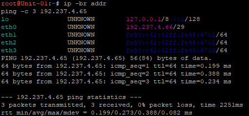

---

## Soal 7: Membangunkan MAGI (listener)

**Soal:** pasang `iptables` dan `netcat-traditional` lewat `/root/<nama>.sh`, lalu nyalakan listener sesuai glosarium: **Casper 5000, Balthasar 5000 dan 5001, Melchior 5000**. Dari Lilith, kirim pesan ke ketiganya dan ke port 5001 Balthasar. Tampilkan pesan yang diterima di tiap node.

**Analogi:** listener adalah petugas loket yang menunggu di nomor loket (port) tertentu. `nc` dari Lilith adalah tamu yang datang membawa surat. Surat yang diterima dicatat di buku (`/root/pesan-<port>.log`).

**Hal penting di script:**

- `nc` bawaan image adalah **OpenBSD netcat**, jadi dipakai **`nc.traditional`** secara eksplisit.
- `nc -l` berhenti setelah satu koneksi, sehingga listener dibungkus `while true` supaya terus hidup.
- Script memeriksa `ss -ltn` lebih dulu. Kalau port sudah didengar, listener tidak dinyalakan lagi, jadi script aman dijalankan berulang tanpa listener ganda.
- `apt-get` memakai `-o Acquire::Check-Date=false`, karena jam node tidak sesuai jam asli dan `trixie-security` menolak tanggal yang dianggap tidak valid.

**`/root/balthasar.sh`** (Casper dan Melchior identik, hanya baris `listen 5001` dihapus):

```
#!/bin/bash
# balthasar.sh - soal 7: pasang iptables + netcat-traditional, nyalakan listener TCP 5000 dan 5001
export DEBIAN_FRONTEND=noninteractive
APT="-o Acquire::Check-Date=false -o Acquire::ForceIPv4=true"

# 1. paket (dilewati kalau sudah ada)
if ! command -v nc.traditional >/dev/null || ! command -v iptables >/dev/null; then
  apt-get $APT update
  apt-get $APT install -y iptables netcat-traditional
fi

# 2. listener: dinyalakan hanya kalau port belum didengar
listen() {
  port=$1
  if ss -ltn | grep -q ":$port "; then
    echo "port $port sudah mendengar, dilewati"
  else
    setsid nohup bash -c "while true; do nc.traditional -l -p $port >> /root/pesan-$port.log; done" >/dev/null 2>&1 &
    sleep 1
    echo "listener port $port dinyalakan"
  fi
}
listen 5000
listen 5001
```

**Mengirim dari Lilith:**

```
ping -c 2 192.237.4.58
echo "Pesan dari Lilith ke Casper port 5000"    | nc -N 192.237.4.58 5000; echo "rc=$?"
echo "Pesan dari Lilith ke Balthasar port 5000" | nc -N 192.237.4.59 5000; echo "rc=$?"
echo "Pesan dari Lilith ke Balthasar port 5001" | nc -N 192.237.4.59 5001; echo "rc=$?"
echo "Pesan dari Lilith ke Melchior port 5000"  | nc -N 192.237.4.60 5000; echo "rc=$?"
```

`-N` membuat `nc` (OpenBSD) di Lilith menutup koneksi setelah pesan terkirim. Ping ber-TTL 62 karena balasan melewati Fuyutsuki dan Toji.

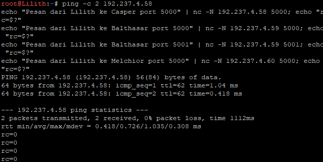

**Membaca pesan di tiap node:**

```
ss -ltn | grep -E ':(5000|5001) '
cat /root/pesan-5000.log      # Balthasar juga: cat /root/pesan-5001.log
```

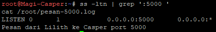
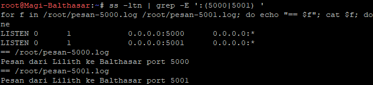
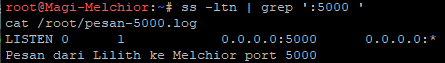

**Hasil:** setiap node menerima pesannya sendiri, pesan Balthasar tidak tertukar antar port, dan baris `LISTEN` tetap ada setelah pesan diterima.

---

## Soal 8: Mengenali kondisi normal

**Soal:** Pen-Pen dan Tokyo3-Core harus melayani dulu. Port 80 menjawab `Welcome to {hostname}`, dan port 8080 di Tokyo3-Core menjawab `syifa imutz`. Tunjukkan `nc` dari Lilith ke ketiga port itu, dan tunjukkan bahwa port yang tidak dilayani (misalnya 22) langsung gagal, bukan menggantung.

**Konsep:** port tanpa layanan dibalas kernel dengan paket **RST**, sehingga klien langsung mendapat `Connection refused`. Bandingkan dengan firewall `DROP` nanti: paket dibuang diam-diam, dan klien menunggu sampai timeout. Kondisi normal ini menjadi pembanding untuk soal-soal firewall berikutnya.

**`/root/tokyo3-core.sh`** (Pen-Pen sama, hanya baris `serve 80`):

```
#!/bin/bash
# tokyo3-core.sh - soal 8: pasang iptables + netcat-traditional, nyalakan layanan yang menjawab
export DEBIAN_FRONTEND=noninteractive
APT="-o Acquire::Check-Date=false -o Acquire::ForceIPv4=true"

# 1. paket (dilewati kalau sudah ada)
if ! command -v nc.traditional >/dev/null || ! command -v iptables >/dev/null; then
  apt-get $APT update
  apt-get $APT install -y iptables netcat-traditional
fi

# 2. layanan: tiap koneksi dijawab satu kalimat lalu ditutup. Dinyalakan hanya kalau port belum didengar
serve() {
  port=$1; text=$2
  if ss -ltn | grep -q ":$port "; then
    echo "port $port sudah mendengar, dilewati"
  else
    setsid nohup bash -c "while true; do echo '$text' | nc.traditional -l -p $port -q 1; done" >/dev/null 2>&1 &
    sleep 1
    echo "layanan port $port dinyalakan"
  fi
}
serve 80 "Welcome to $(hostname)"
serve 8080 "syifa imutz"
```

`-q 1` membuat `nc.traditional` menutup koneksi 1 detik setelah jawaban terkirim, lalu loop segera membuka listener baru.

**Bukti dari Lilith:**

```
ping -c 2 192.237.3.195
nc -w 2 192.237.3.195 80
nc -w 2 192.237.4.106 80
nc -w 2 192.237.4.106 8080
time nc -v -w 5 192.237.3.195 22
time nc -v -w 5 192.237.4.106 22
```

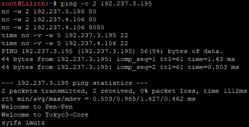

**Hasil:** `Welcome to Pen-Pen`, `Welcome to Tokyo3-Core`, `syifa imutz`. Ping ke Pen-Pen ber-TTL 61 (Maya, Fuyutsuki, Toji).

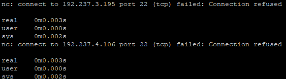

**Hasil:** kedua port 22 `Connection refused` dalam **0,003 detik**. Port itu langsung gagal, tidak menggantung sampai timeout 5 detik.

---

# Babak 2: Sabotase

**Metode yang dipakai untuk soal 9 dan 10:** script asisten dijalankan tanpa membaca isinya. Sebagai gantinya, kondisi router difoto **sebelum** dan **sesudah** sabotase dengan perintah yang sama, lalu dibandingkan dengan `diff`. Setiap baris selisih (selain tanggal) adalah calon penyebab. Dengan cara ini penyebab kedua dan ketiga tidak terlewat, dan setelah perbaikan bisa dibuktikan bahwa kondisi kembali **persis** seperti semula.

```
# foto kondisi (Soal 9, di Shigeru)
{ date; ip -br addr; ip route; ip rule; ip route show table all | grep -v -E '^(local|broadcast)'; \
  sysctl net.ipv4.ip_forward net.ipv4.conf.all.rp_filter net.ipv4.conf.all.forwarding; \
  iptables -S; iptables -t nat -S; iptables -t mangle -S; ip neigh; } > /root/baseline/sebelum.txt 2>&1
```

**Mengambil script ke node:** link Drive biasa mengembalikan halaman HTML `Google Drive - Virus scan warning`, bukan file. Yang berhasil adalah alamat unduhan langsung. Keutuhan file dicek dengan ukuran dan `sha256sum`, tanpa membuka isinya:

```
curl -L -o /root/break_routing.sh "https://drive.usercontent.google.com/download?id=1ub7LjL2BdZdVq6n_AbuqcO416Z8QJGVs&export=download&confirm=t"
wc -c /root/break_routing.sh                 # 1684
sha256sum /root/break_routing.sh | cut -c1-16   # 643d8498126f0b5f
# break_nat.sh: id 1oX7r9BmMPumqrIb71Vbk43Y6CQEOvDRJ, 2146 byte, cbadcd7e97a3b26b
```

Router tidak menyimpan DNS setelah reset. Karena itu `nameserver 192.168.122.1` diisi dulu sebelum `curl`.

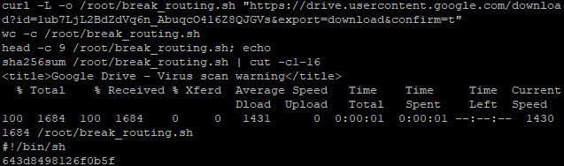

---

## Soal 9: Jalur belakang diutak-atik (`break_routing.sh`)

**Soal:** Lilith tidak mendapat jawaban dari Armisael, padahal Armisael masih bisa ping gateway-nya sendiri. Jalankan `break_routing.sh` di Shigeru, temukan semua penyebab, perbaiki, jelaskan gejalanya, lalu buktikan Lilith bisa ping Armisael kembali.

**Kondisi normal (sebelum sabotase):** Lilith ke Armisael 0% loss, TTL 60. Shigeru: `ip_forward = 1`, default via `192.237.4.129` (Gendou).


**Menjalankan sabotase dan membandingkan:**

```
# di Shigeru
sh /root/break_routing.sh
{ ...perintah foto yang sama... } > /root/baseline/sesudah.txt 2>&1
diff /root/baseline/sebelum.txt /root/baseline/sesudah.txt
```

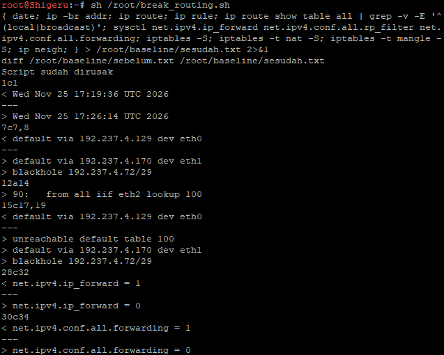

**Gejala:**

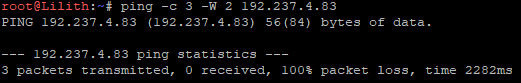
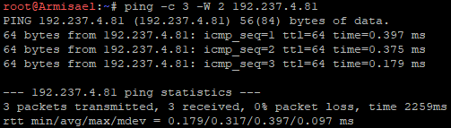

### Empat penyebab

| # | Selisih di `diff` | Arti |
|---|---|---|
| 1 | `net.ipv4.ip_forward = 0` (juga `conf.all.forwarding = 0`) | Shigeru berhenti meneruskan paket antar-interface |
| 2 | `default via 192.237.4.170 dev eth1` (tadinya `via 192.237.4.129 dev eth0`) | Jalan keluar dibelokkan ke Makoto. Default Makoto kembali ke Shigeru, jadi paket berputar |
| 3 | `blackhole 192.237.4.72/29` | Semua paket menuju LAN Dogma (tempat Lilith) dibuang diam-diam |
| 4 | `90: from all iif eth2 lookup 100` + `unreachable default table 100` | Paket yang **masuk dari Monolith** (`eth2`) dipaksa memakai tabel 100, yang isinya hanya "tidak ada jalan" |

**Kenapa Armisael masih bisa ping gateway:** paket itu ditujukan ke `192.237.4.81`, alamat milik Shigeru sendiri. Linux memeriksa tabel `local` lebih dulu (aturan prioritas 0), sebelum aturan prioritas 90. Paket diterima Shigeru sendiri dan tidak perlu diteruskan, jadi penyebab 1, 3, dan 4 tidak berlaku. Balasannya keluar lewat rute terhubung `192.237.4.80/29`.

**Kenapa Lilith gagal:** pada jalur pergi, paket Lilith tiba di Shigeru dan harus diteruskan ke Armisael, tetapi `ip_forward = 0` menjatuhkannya (penyebab 1). Seandainya diteruskan, balasan Armisael masuk dari `eth2` dan jatuh ke tabel 100 yang `unreachable` (penyebab 4), lalu tujuan Dogma terkena `blackhole` (penyebab 3). Penyebab 2 merusak semua jalur keluar lain. Setiap penyebab cukup untuk memutus sendiri, jadi keempatnya harus diperbaiki.

### Perbaikan

```
# di Shigeru
sysctl -w net.ipv4.ip_forward=1                       # penyebab 1
ip route replace default via 192.237.4.129 dev eth0   # penyebab 2
ip route del blackhole 192.237.4.72/29                # penyebab 3
ip rule del iif eth2 lookup 100 priority 90           # penyebab 4
ip route flush table 100                              # penyebab 4
{ ...perintah foto yang sama... } > /root/baseline/pulih.txt 2>&1
diff /root/baseline/sebelum.txt /root/baseline/pulih.txt
```

**Hasil:** `diff` hanya menyisakan baris tanggal. Rute, aturan, dan forwarding kembali persis seperti kondisi normal. `sysctl ip_forward=1` ikut mengembalikan `conf.all.forwarding`.

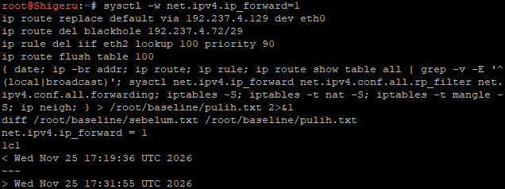

```
# di Lilith
ping -c 3 192.237.4.83
```

**Hasil:** 0% loss, TTL 60, sama seperti sebelum sabotase.

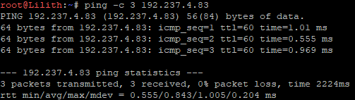

---

## Soal 10: Para pilot terkunci di dalam (`break_nat.sh`)

**Soal:** Unit-01, Unit-02, dan Unit-00 di Cage tidak bisa ping 8.8.8.8, padahal Spy di Intel baik-baik saja dan ping Cage ke Lilith normal. Jalankan `break_nat.sh` di Misato dan di Gendou. Jelaskan kenapa Cage terdampak tapi Intel tidak, buktikan Unit-01 bisa ping 8.8.8.8, dan sebutkan di router mana alamat sumber diterjemahkan.

**Kondisi normal:** Unit-01 dan Spy ping 8.8.8.8 0% loss, TTL 110. NAT Gendou hanya berisi `MASQUERADE` untuk `192.237.0.0/16`, dan tabel NAT Misato kosong.

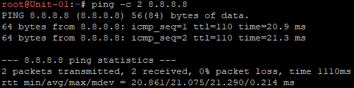

**Sabotase (Misato dulu, lalu Gendou), foto, dan `diff`:**

```
sh /root/break_nat.sh
{ date; ip -br addr; ip route; ip rule; sysctl net.ipv4.ip_forward; iptables -S; iptables -t nat -S; iptables -t mangle -S; } > /root/baseline/sesudah.txt 2>&1
diff /root/baseline/sebelum.txt /root/baseline/sesudah.txt
```

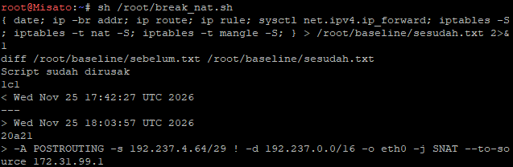
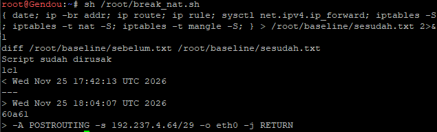

**Gejala:**


### Dua penyebab

| Router | Aturan yang ditambahkan | Arti |
|---|---|---|
| Misato | `-A POSTROUTING -s 192.237.4.64/29 ! -d 192.237.0.0/16 -o eth0 -j SNAT --to-source 172.31.99.1` | Paket Cage yang menuju luar diubah pengirimnya menjadi `172.31.99.1`. Alamat itu tidak bisa dibalas, dan juga tidak cocok dengan `MASQUERADE` Gendou (`-s 192.237.0.0/16`) |
| Gendou | `-I POSTROUTING 1 -s 192.237.4.64/29 -o eth0 -j RETURN` | Disisipkan **sebelum** `MASQUERADE`, sehingga paket Cage keluar dari rantai tanpa diterjemahkan. Alamat privat `192.237.4.x` keluar ke NAT1 dan balasannya tidak bisa kembali |

**Kenapa Cage terdampak tapi Intel tidak:** kedua aturan hanya cocok untuk sumber **`192.237.4.64/29`**, subnet Cage. Spy berada di `192.237.4.100/30`, jadi tidak pernah cocok. Kedua aturan juga hanya berlaku untuk traffic keluar (`! -d 192.237.0.0/16` di Misato, `-o eth0` di Gendou). Itu sebabnya Cage ke Lilith tetap normal.

### Perbaikan bertahap

Perbaikan dilakukan satu per satu untuk membuktikan bahwa kedua penyebab sama-sama harus dihapus.

```
# 1) Misato
iptables -t nat -D POSTROUTING -s 192.237.4.64/29 ! -d 192.237.0.0/16 -o eth0 -j SNAT --to-source 172.31.99.1
# uji tengah di Unit-01
ping -c 3 -W 2 8.8.8.8
```

**Hasil uji tengah:** masih 100% loss. Satu perbaikan belum cukup, karena aturan `RETURN` di Gendou masih aktif.


```
# 2) Gendou
iptables -t nat -D POSTROUTING -s 192.237.4.64/29 -o eth0 -j RETURN
iptables -t nat -Z POSTROUTING      # nolkan counter supaya bukti bersih
# di Unit-01
ping -c 3 -W 2 8.8.8.8
```

**Hasil:** 0% loss, TTL 110.


### Router yang menerjemahkan alamat sumber: Gendou

```
# di Gendou dan di Misato
iptables -t nat -L POSTROUTING -n -v
```


Setelah counter dinolkan, `MASQUERADE` Gendou mencatat **1 paket, 84 byte**, yaitu paket ping pertama Unit-01. Misato tidak memiliki aturan NAT sama sekali, jadi Misato hanya meneruskan paket tanpa menerjemahkan.

**Kondisi pulih penuh:**


Kedua `diff` hanya menyisakan baris tanggal.

---

## Alur demo singkat

Jalankan [Persiapan sebelum demo](#persiapan-sebelum-demo) lebih dulu. Selalu cek prompt sebelum menempel.

| Soal | Node | Perintah | Yang ditunjukkan |
|---|---|---|---|
| 1 | - | Buka tabel VLSM dan pohon IP | Hitungan Quarters /23, jalur dilingkari |
| 2 | Tiap router | `ip -br addr; cat /proc/sys/net/ipv4/ip_forward` | IP sesuai tabel, nilai `1` |
| 2 | Router anak | `ping -c 2 <IP parent>` | 0% loss |
| 2 | Gendou | `ip -br addr show eth0; ip route \| grep default` | IP dari DHCP NAT1 |
| 3 | Gendou | `ip route; ip route \| wc -l` | 21 rute statis, total 31 |
| 3 | Armisael | `ping -c 3 192.237.4.74; ping -c 3 192.237.3.130; ping -c 3 192.237.2.2` | 0% loss, TTL 60/60/61 |
| 4 | Armisael, Lilith | `ping -c 3 8.8.8.8; ping -c 3 deb.debian.org` | Berhasil |
| 4 | Gendou | `iptables -t nat -L POSTROUTING -n -v` | Counter `MASQUERADE` bertambah |
| 5 | Gendou | `iptables -S` | Policy DROP + 7 aturan izin |
| 5 | Armisael | `ping -c 2 8.8.8.8` | Tetap berhasil |
| 6 | GNS3 + Unit-01 | Stop/Start Unit-01, lalu `ip -br addr; ping -c 3 192.237.4.65` | IP kembali sendiri |
| 7 | Lilith | 4 perintah `echo ... \| nc -N ...` | `rc=0` |
| 7 | Casper, Balthasar, Melchior | `ss -ltn \| grep -E ':(5000\|5001) '; cat /root/pesan-*.log` | Pesan diterima |
| 8 | Lilith | `nc -w 2` ke 3.195:80, 4.106:80, 4.106:8080; `time nc -v -w 5 <ip> 22` | 3 balasan, port 22 refused seketika |
| 9 | Shigeru | foto `sebelum.txt`, `sh /root/break_routing.sh`, foto `sesudah.txt`, `diff` | 4 penyebab |
| 9 | Lilith, Armisael | `ping 192.237.4.83` / `ping 192.237.4.81` | Gejala sesuai soal |
| 9 | Shigeru, Lilith | 5 perintah perbaikan, `diff` pulih, `ping 192.237.4.83` | Pulih, TTL 60 |
| 10 | Misato, Gendou | foto, `sh /root/break_nat.sh`, foto, `diff` | 1 aturan per router |
| 10 | Unit-01, Spy | `ping 8.8.8.8` | Cage gagal, Intel berhasil |
| 10 | Misato, Unit-01, Gendou, Unit-01 | Hapus SNAT, ping, hapus RETURN, ping | Gagal dulu, lalu berhasil |
| 10 | Gendou, Misato | `iptables -t nat -L POSTROUTING -n -v` | Hanya Gendou yang menerjemahkan |

**Catatan saat mengulang sabotase di depan asisten:**

- `break_routing.sh` menolak jalan kalau aturan `iif ... lookup 100` masih ada. Setelah perbaikan soal 9 aturan itu sudah terhapus, jadi script bisa dijalankan ulang.
- `break_nat.sh` menghapus lalu menambah aturannya sendiri, jadi aman diulang.
- Ambil ulang foto `sebelum.txt` tepat sebelum menjalankan sabotase, supaya pembandingnya sesuai kondisi saat demo.

---

## Kendala dan catatan teknis

1. **Konfigurasi router tidak autostart.** IP, rute, dan `iptables` router hilang saat node di-reset, jadi `/root/<nama>.sh` harus dijalankan ulang (Gendou dulu). Image ini menjalankan `/root/init.sh` saat start (lihat `/etc/debinet-init.sh`), sehingga autostart router bisa ditambahkan. Mekanisme itu belum diuji dan belum dipakai.
2. **Link GNS3 macet satu arah.** Pernah terjadi di Fuyutsuki-Gendou dan Ritsuko-Asuka: ARP `FAILED` padahal konfigurasi benar.
   - Obat pertama: `ip link set eth0 down; ip link set eth0 up; bash /root/<nama>.sh` di node anak.
   - Kalau tetap gagal, `tcpdump` di kedua ujung membuktikan balasan ARP tidak sampai.
   - Suspend/Resume link dan restart node tidak menolong. Yang berhasil: hapus kabel di GNS3, sambung ulang di port yang sama, lalu jalankan ulang script kedua ujung.
3. **Jam node tidak sesuai jam asli**, sehingga `apt-get update` gagal di `trixie-security`. Solusinya `-o Acquire::Check-Date=false`. Ini perlu diperhatikan untuk aturan berbasis waktu (soal 14).
4. **DNS router kosong setelah reset.** Isi `nameserver 192.168.122.1` sebelum `curl` atau `apt`. Host tidak terdampak karena DNS ditulis oleh `/etc/network/interfaces`.
5. **Unduhan Google Drive.** Link biasa memberi halaman `Virus scan warning`. Pakai `drive.usercontent.google.com/download?id=...&confirm=t` dan cek `wc -c` serta `sha256sum` sebelum menjalankan file.
6. **Salah menempel ke node lain.** Perintah Gendou pernah tertempel di Shigeru dan menimpa rute ke Makoto. Selalu cek prompt `root@NAMA`, dan jangan ikut menempel baris prompt atau output.
7. **Nama script Gendou.** Soal menyebut `gendo.sh`, sedangkan node bernama Gendou dan script disimpan di `/root/gendou.sh`. Kalau asisten meminta nama persis, buat tautan: `ln -sf /root/gendou.sh /root/gendo.sh`.

---

## Lampiran: script semua router

Semua script aman dijalankan berulang (`ip addr replace`, `ip route replace`). Script Gendou ada di [Soal 5](#script-lengkap-gendou-rootgendoush-soal-2-sampai-5).

<details>
<summary><code>/root/hikari.sh</code></summary>

```bash
#!/bin/bash
# hikari.sh - konfigurasi Hikari (aman dijalankan berulang)

# IP forwarding
echo 1 > /proc/sys/net/ipv4/ip_forward

ip addr replace 192.237.4.110/30   dev eth0   # uplink ke Gendou
ip addr replace 192.237.4.137/30   dev eth1   # link ke Kaworu
ip addr replace 192.237.2.1/24     dev eth2   # gateway LAN Switch-Comm
for i in 0 1 2; do ip link set eth$i up; done
# --- static routes ---
ip route replace 192.237.3.224/27  via 192.237.4.138   # Kaworu
ip route replace default via 192.237.4.109   # Gendou
```

</details>

<details>
<summary><code>/root/kaworu.sh</code></summary>

```bash
#!/bin/bash
# kaworu.sh - konfigurasi Kaworu (aman dijalankan berulang)

# IP forwarding
echo 1 > /proc/sys/net/ipv4/ip_forward

ip addr replace 192.237.4.138/30   dev eth0   # uplink ke Hikari
ip addr replace 192.237.3.225/27   dev eth1   # gateway LAN Switch-Relay
for i in 0 1; do ip link set eth$i up; done
# --- static routes ---
ip route replace default via 192.237.4.137   # Hikari
```

</details>

<details>
<summary><code>/root/asuka.sh</code></summary>

```bash
#!/bin/bash
# asuka.sh - konfigurasi Asuka (aman dijalankan berulang)

# IP forwarding
echo 1 > /proc/sys/net/ipv4/ip_forward

ip addr replace 192.237.4.118/30   dev eth0   # uplink ke Gendou
ip addr replace 192.237.4.153/30   dev eth1   # link ke Kensuke
ip addr replace 192.237.4.157/30   dev eth2   # link ke Ritsuko
ip addr replace 192.237.4.97/30    dev eth3   # gateway LAN Switch-Archive
for i in 0 1 2 3; do ip link set eth$i up; done
# --- static routes ---
ip route replace 192.237.3.128/26  via 192.237.4.154   # Kensuke
ip route replace 192.237.4.48/29   via 192.237.4.158   # Ritsuko
ip route replace default via 192.237.4.117   # Gendou
```

</details>

<details>
<summary><code>/root/kensuke.sh</code></summary>

```bash
#!/bin/bash
# kensuke.sh - konfigurasi Kensuke (aman dijalankan berulang)

# IP forwarding
echo 1 > /proc/sys/net/ipv4/ip_forward

ip addr replace 192.237.4.154/30   dev eth0   # uplink ke Asuka
ip addr replace 192.237.3.129/26   dev eth1   # gateway LAN Switch-Bunker
for i in 0 1; do ip link set eth$i up; done
# --- static routes ---
ip route replace default via 192.237.4.153   # Asuka
```

</details>

<details>
<summary><code>/root/ritsuko.sh</code></summary>

```bash
#!/bin/bash
# ritsuko.sh - konfigurasi Ritsuko (aman dijalankan berulang)

# IP forwarding
echo 1 > /proc/sys/net/ipv4/ip_forward

ip addr replace 192.237.4.158/30   dev eth0   # uplink ke Asuka
ip addr replace 192.237.4.49/29    dev eth1   # gateway LAN Switch-Lab
for i in 0 1; do ip link set eth$i up; done
# --- static routes ---
ip route replace default via 192.237.4.157   # Asuka
```

</details>

<details>
<summary><code>/root/kaji.sh</code></summary>

```bash
#!/bin/bash
# kaji.sh - konfigurasi Kaji (aman dijalankan berulang)

# IP forwarding
echo 1 > /proc/sys/net/ipv4/ip_forward

ip addr replace 192.237.4.122/30   dev eth0   # uplink ke Gendou
ip addr replace 192.237.4.101/30   dev eth1   # gateway LAN Switch-Intel
for i in 0 1; do ip link set eth$i up; done
# --- static routes ---
ip route replace default via 192.237.4.121   # Gendou
```

</details>

<details>
<summary><code>/root/misato.sh</code></summary>

```bash
#!/bin/bash
# misato.sh - konfigurasi Misato (aman dijalankan berulang)

# IP forwarding
echo 1 > /proc/sys/net/ipv4/ip_forward

ip addr replace 192.237.4.126/30   dev eth0   # uplink ke Gendou
ip addr replace 192.237.4.65/29    dev eth1   # gateway LAN Switch-Cage
for i in 0 1; do ip link set eth$i up; done
# --- static routes ---
ip route replace default via 192.237.4.125   # Gendou
```

</details>

<details>
<summary><code>/root/shigeru.sh</code></summary>

```bash
#!/bin/bash
# shigeru.sh - konfigurasi Shigeru (aman dijalankan berulang)

# IP forwarding
echo 1 > /proc/sys/net/ipv4/ip_forward

ip addr replace 192.237.4.130/30   dev eth0   # uplink ke Gendou
ip addr replace 192.237.4.169/30   dev eth1   # link ke Makoto
ip addr replace 192.237.4.81/29    dev eth2   # gateway LAN Switch-Monolith
for i in 0 1 2; do ip link set eth$i up; done
# --- static routes ---
ip route replace 192.237.4.88/29   via 192.237.4.170   # Makoto
ip route replace default via 192.237.4.129   # Gendou
```

</details>

<details>
<summary><code>/root/makoto.sh</code></summary>

```bash
#!/bin/bash
# makoto.sh - konfigurasi Makoto (aman dijalankan berulang)

# IP forwarding
echo 1 > /proc/sys/net/ipv4/ip_forward

ip addr replace 192.237.4.170/30   dev eth0   # uplink ke Shigeru
ip addr replace 192.237.4.89/29    dev eth1   # gateway LAN Switch-Radar
for i in 0 1; do ip link set eth$i up; done
# --- static routes ---
ip route replace default via 192.237.4.169   # Shigeru
```

</details>

<details>
<summary><code>/root/fuyutsuki.sh</code></summary>

```bash
#!/bin/bash
# fuyutsuki.sh - konfigurasi Fuyutsuki (aman dijalankan berulang)

# IP forwarding
echo 1 > /proc/sys/net/ipv4/ip_forward

ip addr replace 192.237.4.134/30   dev eth0   # uplink ke Gendou
ip addr replace 192.237.4.161/30   dev eth1   # link ke Maya
ip addr replace 192.237.4.165/30   dev eth2   # link ke Toji
ip addr replace 192.237.4.57/29    dev eth3   # gateway LAN Switch-Terminal
for i in 0 1 2 3; do ip link set eth$i up; done
# --- static routes ---
ip route replace 192.237.3.192/27  via 192.237.4.162   # Maya
ip route replace 192.237.4.72/29   via 192.237.4.166   # Toji
ip route replace default via 192.237.4.133   # Gendou
```

</details>

<details>
<summary><code>/root/maya.sh</code></summary>

```bash
#!/bin/bash
# maya.sh - konfigurasi Maya (aman dijalankan berulang)

# IP forwarding
echo 1 > /proc/sys/net/ipv4/ip_forward

ip addr replace 192.237.4.162/30   dev eth0   # uplink ke Fuyutsuki
ip addr replace 192.237.3.193/27   dev eth1   # gateway LAN Switch-Medic
for i in 0 1; do ip link set eth$i up; done
# --- static routes ---
ip route replace default via 192.237.4.161   # Fuyutsuki
```

</details>

<details>
<summary><code>/root/toji.sh</code></summary>

```bash
#!/bin/bash
# toji.sh - konfigurasi Toji (aman dijalankan berulang)

# IP forwarding
echo 1 > /proc/sys/net/ipv4/ip_forward

ip addr replace 192.237.4.166/30   dev eth0   # uplink ke Fuyutsuki
ip addr replace 192.237.4.73/29    dev eth1   # gateway LAN Switch-Dogma
for i in 0 1; do ip link set eth$i up; done
# --- static routes ---
ip route replace default via 192.237.4.165   # Fuyutsuki
```

</details>

<details>
<summary><code>/root/yui.sh</code></summary>

```bash
#!/bin/bash
# yui.sh - konfigurasi Yui (aman dijalankan berulang)

# IP forwarding
echo 1 > /proc/sys/net/ipv4/ip_forward

ip addr replace 192.237.4.114/30   dev eth0   # uplink ke Gendou
ip addr replace 192.237.4.149/30   dev eth1   # link ke Shinji
ip addr replace 192.237.4.141/30   dev eth2   # link ke Rei
ip addr replace 192.237.4.145/30   dev eth3   # link ke Mari
ip addr replace 192.237.3.1/25     dev eth4   # gateway LAN Switch-Hangar
for i in 0 1 2 3 4; do ip link set eth$i up; done
# --- static routes ---
ip route replace 192.237.0.0/23    via 192.237.4.142   # Rei
ip route replace 192.237.4.32/28   via 192.237.4.146   # Mari
ip route replace 192.237.4.0/27    via 192.237.4.150   # Shinji
ip route replace default via 192.237.4.113   # Gendou
```

</details>

<details>
<summary><code>/root/rei.sh</code></summary>

```bash
#!/bin/bash
# rei.sh - konfigurasi Rei (aman dijalankan berulang)

# IP forwarding
echo 1 > /proc/sys/net/ipv4/ip_forward

ip addr replace 192.237.4.142/30   dev eth0   # uplink ke Yui
ip addr replace 192.237.0.1/23     dev eth1   # gateway LAN Switch-Quarters
for i in 0 1; do ip link set eth$i up; done
# --- static routes ---
ip route replace default via 192.237.4.141   # Yui
```

</details>

<details>
<summary><code>/root/mari.sh</code></summary>

```bash
#!/bin/bash
# mari.sh - konfigurasi Mari (aman dijalankan berulang)

# IP forwarding
echo 1 > /proc/sys/net/ipv4/ip_forward

ip addr replace 192.237.4.146/30   dev eth0   # uplink ke Yui
ip addr replace 192.237.4.33/28    dev eth1   # gateway LAN Switch-Dock
for i in 0 1; do ip link set eth$i up; done
# --- static routes ---
ip route replace default via 192.237.4.145   # Yui
```

</details>

<details>
<summary><code>/root/shinji.sh</code></summary>

```bash
#!/bin/bash
# shinji.sh - konfigurasi Shinji (aman dijalankan berulang)

# IP forwarding
echo 1 > /proc/sys/net/ipv4/ip_forward

ip addr replace 192.237.4.150/30   dev eth0   # uplink ke Yui
ip addr replace 192.237.4.1/27     dev eth1   # gateway LAN Switch-Garden
for i in 0 1; do ip link set eth$i up; done
# --- static routes ---
ip route replace default via 192.237.4.149   # Yui
```

</details>

